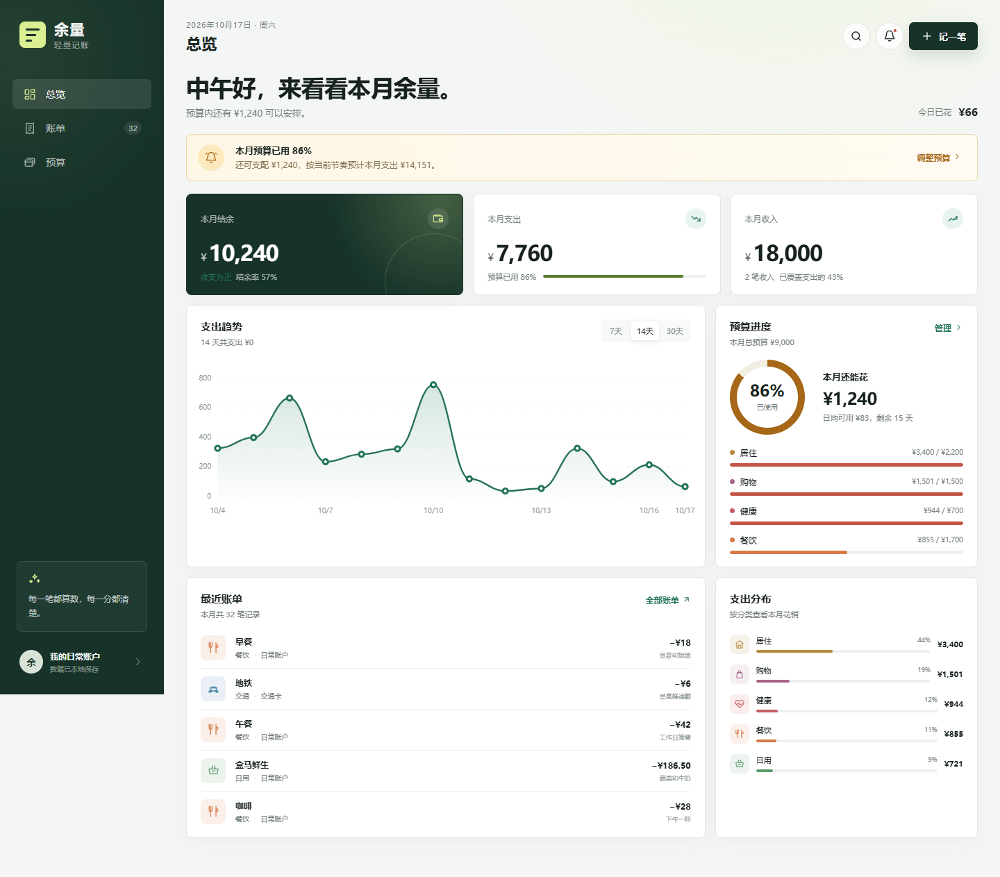

# 余量

一款带预算提醒的轻量记账网页应用。无需安装依赖，记账数据保存在当前浏览器本地。



## 功能

- 记录收入与支出，支持新增、编辑和删除。
- 设置本月总预算与不同分类预算。
- 预算使用达到自定义提醒线时显示预警。
- 分类超支、消费节奏偏快时提供即时提醒。
- 查看本月结余、收入、支出、趋势图和分类分布。
- 按关键词搜索账单，按收入或支出筛选。
- 适配电脑、平板和手机浏览器。
- 所有数据保存在浏览器 `localStorage` 中，不会上传到服务器。

## 目录

```text
.
├── index.html      # 页面入口
├── styles.css      # 页面样式与响应式布局
├── app.js          # 记账、预算、图表和本地存储逻辑
├── server.js       # 零依赖本地静态服务器
├── package.json    # 启动命令
└── docs/           # README 截图
```

## 快速开始

### 方式一：直接打开

双击 `index.html`，使用浏览器打开即可。

这种方式适合在电脑上快速体验，但部分手机浏览器不允许直接打开本地 HTML 文件。

### 方式二：本地服务器

需要安装 Node.js 18 或更高版本。在项目目录执行：

```bash
node server.js
```

或：

```bash
npm start
```

启动后打开：

```text
http://localhost:4173
```

## 手机使用教程

手机和电脑连接同一个 Wi-Fi，然后按以下步骤操作：

1. 在电脑上进入项目目录。
2. 执行 `node server.js`。
3. 终端会显示一个局域网地址，例如 `http://192.168.1.20:4173`。
4. 在手机浏览器中打开该地址。
5. 点击浏览器菜单中的“添加到主屏幕”或“添加到书签”，方便下次进入。

如果终端没有显示地址，可在电脑终端执行 `ipconfig`，找到当前 Wi-Fi 网卡的 IPv4 地址，再访问：

```text
http://电脑的IPv4地址:4173
```

使用时需要保持电脑开机，并保证手机和电脑仍在同一个 Wi-Fi。若手机无法连接，请检查 Windows 防火墙是否允许 Node.js 访问专用网络。

### 添加到手机主屏幕

- iPhone：使用 Safari 打开，点击“分享”，选择“添加到主屏幕”。
- Android：使用 Chrome 打开，点击右上角菜单，选择“添加到主屏幕”。

添加后打开的是同一个网页应用。它不是原生 APK 或 IPA 安装包，但可以像普通应用一样从主屏幕启动。

## 使用说明

### 记录一笔账

点击右上角的“记一笔”，选择支出或收入，填写金额和分类，再按需要填写日期、账户与备注。保存后，本月结余和预算进度会立即更新。

首次打开时会显示一组本月示例账单。示例数据仅用于展示预算提醒效果，可以直接编辑或删除。

### 设置预算

进入“预算”，在“本月总预算”中修改整体预算，在“分类预算”中分别修改餐饮、日用、交通等预算。修改完成并离开输入框后会自动保存。

### 设置预算提醒

拖动“预算使用提醒线”可以设置触发提醒的比例，默认是 `80%`。当总预算或分类预算达到该比例时，总览页会显示提醒，也可以通过右上角铃铛查看提醒详情。

### 搜索和编辑账单

进入“账单”，使用搜索框查找备注、分类或账户，也可以按“全部、支出、收入”筛选。点击任意一条账单即可编辑或删除。

### 恢复演示数据

进入“预算”，点击“恢复演示”，确认后会重新生成示例账单和默认预算。该操作会覆盖当前浏览器中的账单与预算设置。

## 数据和隐私

- 数据只保存在访问该页面的浏览器中，不会同步到云端。
- 不同浏览器、不同设备之间的数据彼此独立。
- 清理浏览器网站数据后，账单和预算也会被清除。
- 当前版本没有账号登录、跨设备同步或多人共享功能。

## 自定义

- 分类名称、颜色和图标位于 `app.js` 中的 `EXPENSE_CATEGORIES` 与 `INCOME_CATEGORIES`。
- 默认预算位于 `app.js` 中的 `DEFAULT_BUDGETS`。
- 首次打开的示例账单位于 `app.js` 中的 `createSeedState()`。
- 页面颜色和响应式样式位于 `styles.css` 顶部的 CSS 变量中。

## 浏览器支持

建议使用最新版 Chrome、Edge、Safari 或 Firefox。应用使用了 `localStorage`、CSS Grid、SVG 和现代 JavaScript API。

## 部署

该应用没有后端依赖，可以部署到任意静态网站托管服务。将 `index.html`、`styles.css` 和 `app.js` 放在同一目录即可。

## License

本项目暂未指定开源许可证。如需公开分发，请先补充合适的许可证文件。
